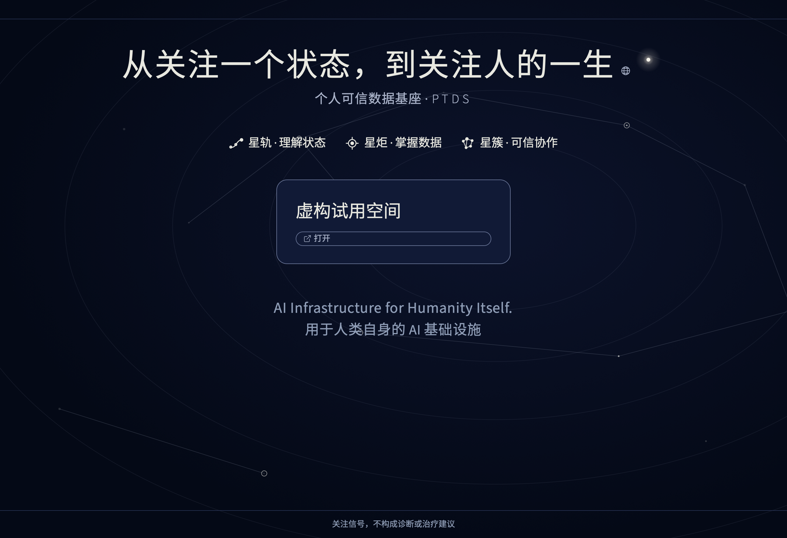
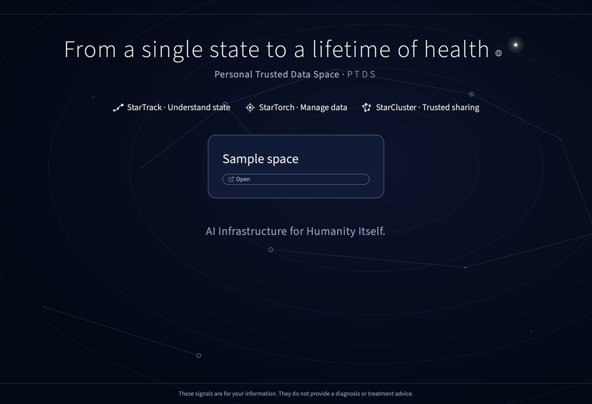
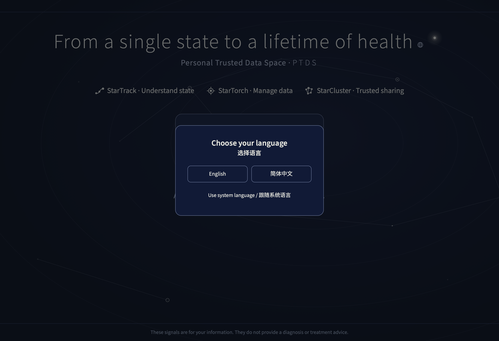
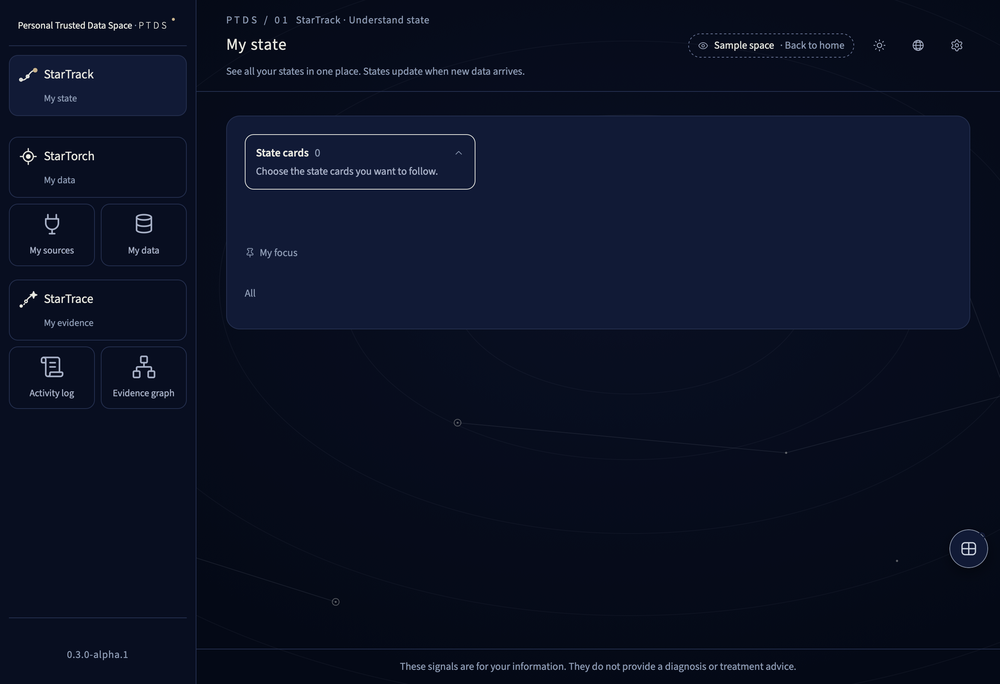

# PTDS v0.3.0-alpha.2

[简体中文](README.md)


Local-first personal health data space for macOS. Trial release. [Chinese guide](README.md).

[](https://github.com/osszhaoke/ptd-substrate/actions/workflows/ci.yml) [](LICENSE) [](CHANGELOG.en.md)

Your health data stay on your Mac. By default the app runs offline and listens only on loopback. The results are signals for your attention. They do not provide a diagnosis or treatment advice.

## Screenshots
| Home · 简体中文 | Home · English |
| --- | --- |
|  |  |




## What you can do
StarTorch manages data and sources. StarTrack shows state cards. StarCluster organizes access and collaboration. Start with a CSV file and review the records yourself. Sharing is closed in the partner edition. User names and original records keep their original text.

## Quick start
Download the archive and external SHA256SUMS from the [Release](https://github.com/osszhaoke/ptd-substrate/releases/tag/v0.3.0-alpha.2). Run `shasum -a 256 -c SHA256SUMS` in the download directory. Extract the verified archive, enter its directory and run `sh scripts/verify_release.sh`. The installer uses the Python standard library. The rehearsal used macOS 27.0.1 on Apple silicon with Python 3.14.8. Other combinations are unverified. See the [installation guide](AGENT_INSTALL.en.md).

Choose the folder, display name and time zone yourself. Use a new folder and an unused instance ID. Run as a regular user.
```sh
SPACE_ROOT="$HOME/PTDS-trial-spaces"
SPACE_ID="partner-demo"
SPACE_NAME="Sample space"
SPACE_TZ="Asia/Shanghai"
TRIAL_CONFIG="$SPACE_ROOT/partner-settings.json"
```

```sh
mkdir -p "$SPACE_ROOT"
PYTHONPATH="$PWD/app:$PWD/app/core" python3 -B app/core/ptds_instance.py \
  --root "$SPACE_ROOT" --id "$SPACE_ID" --kind DEMO --accept SYNTHETIC --tz "$SPACE_TZ" --name "$SPACE_NAME"
python3 -B app/tools/partner_trial_setup.py --data-root "$SPACE_ROOT" --output "$TRIAL_CONFIG"
python3 -B scripts/start_trial.py --root "$SPACE_ROOT" --config "$TRIAL_CONFIG"
```

In the installer, choose the key PARTNER and enter the same ID, display name and time zone. Choose 1 for fictional data. Check the target and type YES yourself to create the configuration. Open the printed 127.0.0.1 address, choose your language and open the instance. Go to My sources → Files and reports → CSV file. Select data/sample-import.csv to review both rows. Their times match so the app refuses to save them together. For the save exercise, make a fictional copy with two times using the [trial tasks](docs/community/trial-tasks.en.md). Check both rows and confirm the save yourself. Use Ctrl+C to quit.

| Module | English | Purpose |
| --- | --- | --- |
| 星炬 (torch) | StarTorch | Manage data and sources. |
| 星轨 (track) | StarTrack | Understand state and view state cards. |
| 星簇 (cluster) | StarCluster | Manage permissions and collaboration. |
| 星痕 | StarTrace | Trace records and evidence. |

For a new personal space that you explicitly want to accept both types, use a new folder, pass `--kind REAL --accept REAL SYNTHETIC` when creating it and choose option 2 in the installer. An existing space with a different policy is rejected. Its data are untouched.

Before you import a file, read [Health and privacy](docs/community/health-and-privacy.en.md). For a first visit, follow [Trial tasks](docs/community/trial-tasks.en.md).

## Capabilities and evidence
| Feature | Evidence | In this release |
| --- | --- | --- |
| Raw genetic files | Fictional checks only | Import, look up, check coverage and delete by file. No interpretation. |
| Local lab report OCR with review before save | Fictional verification only | Review every row and its source before saving. |
| CSV, review and save | Fictional checks only | Both original rows reach review. You can check and save a fictional copy with two times. |
| Lists, details and sources | Fictional checks only | View readings and their source relationships in the selected space. Use your own copy to check the original CSV text. |
| Corrections and deletions | Fictional checks only | Corrections and withdrawals append a history version. |
| Language selection and switching | Fictional checks only | Choose a language at first launch or use the globe later. Inner pages show the disclaimer in that language. |
| Oura | Fictional checks only | Use your own app and local credentials for this instance. You approve access yourself. |
| Garmin and Whoop | Fictional checks only | Offline checks are available. Account access is unavailable. |
| Starling | Fictional checks only | This edition hides the entry and the floating button. |
| Phone sharing, wristband bridge and grants | Unavailable | Trial access rules hide these features. |
| Home editing | Unavailable | The home page uses the default text. |
| Maintainer acceptance | Pending | Acceptance for this release has not been recorded. |

## Known issues

- Start with a CSV file. Before saving, check the proposed records, the destination and the data type. Then confirm the save yourself.
- To use Oura, configure it and approve access yourself. Garmin and Whoop offer read-only checks in this edition. Account connections are unavailable for these two devices.
- Saving records and opening pages may take longer when you have more data.
- Your health data stays on this computer. Remove personal health information and credentials before sharing feedback.
- Include a screenshot and the steps you took. Cover any personal information in the screenshot.

[The installation archive is available](https://github.com/osszhaoke/ptd-substrate/releases/tag/v0.3.0-alpha.2). Maintainer acceptance is pending.

You can correct or delete a record. After deletion, it disappears from the current list. Its earlier versions remain available in the history. Check the selected instance and record first.

This edition hides sharing and permissions, the state lab and rule editor, card pins and settings, thresholds, batch import, medication, evidence packages, notes, phone sharing, the wristband bridge, the reminder calendar, profile editing and device panel settings. Device guides remain available. Garmin and Whoop offer read-only checks. Starling is unavailable in the partner edition.

The home title and card text use the defaults in this edition.

Instance names, names you enter, source descriptions and historical record text stay in their original language when you select English. Known system-generated table import labels follow the selected language. Original uploaded file names, unknown templates and user text stay in their original language.

The partner edition requests only its available features. The phone bridge is unavailable. Raw genetic files stay on this computer. You can import a file, check its properties, look up a locus, check coverage and delete the file. PTDS does not interpret disease or risk.

The iPhone sync shortcut is listed under its Chinese name, “同步到星炬”, in the local guide.

Fictional results, medians of three runs per size on a Mac16,1 with Apple M4, 16 GiB, macOS 27.0.1 and Python 3.14.8. Save measures the whole batch transaction. Open and reload measure the local browser until the complete list is rendered.

| Rows | Save batch (s) | First My data open (s) | Reload (s) |
| ---: | ---: | ---: | ---: |
| 1,000 | 0.136 | 0.074 | 0.049 |
| 10,000 | 1.370 | 0.219 | 0.147 |
| 76,000 | 10.493 | 1.198 | 0.879 |

Unsigned and unnotarized. Signing and notarization are planned. Windows is unsupported. Actual user performance is unverified.

## Repository layout
`app/` contains the product and installer. `scripts/` provides verification and startup. `data/` contains the fictional CSV. `tests/` contains the explicit release checks. `docs/` holds the bilingual guides and screenshots. `licenses/` contains third-party notices. `SBOM.json` lists dependencies.

## Offline tests
Use an isolated HOME in a fresh extraction or clean clone. The explicit release tests run without Node. Development language and device component tests use Node and are outside the public install file set.
```sh
sh scripts/verify_release.sh
python3 -B -I scripts/check_publication.py
python3 -B -I tests/release_smoke.py
```

Maintainers can run `python3 -B scripts/build_release.py --out ../ptd-substrate-v0.3.0-alpha.2.zip` to rebuild the ZIP from a verified directory. The external SHA256SUMS checks the ZIP. Its internal namesake checks every other repository file. The archive digest and external seal cover the internal manifest itself.

## Documentation and feedback
| Topic | Guide |
| --- | --- |
| Setup and first launch | [Install](docs/guides/install-macos.en.md) · [First launch](docs/guides/first-run.en.md) |
| Wearables | [Oura](docs/guides/oura.en.md) · [Garmin](docs/guides/garmin.en.md) · [Whoop](docs/guides/whoop.en.md) |
| Product, architecture, privacy and operations | [Documentation](docs/README.en.md) |
| Partner guides | [Health and privacy](docs/community/health-and-privacy.en.md) · [Trial tasks](docs/community/trial-tasks.en.md) · [Uninstall and delete](docs/community/uninstall.en.md) · [Frequently asked questions](docs/community/faq.en.md) |
| Privacy, support and plans | [Threat model](docs/community/threat-model.en.md) · [Feedback guide](docs/community/feedback.en.md) · [Updates](docs/community/updates.en.md) · [Roadmap draft](docs/community/roadmap.en.md) |
| Agent installation | [Installation protocol](AGENT_INSTALL.en.md) |

[Contributing](CONTRIBUTING.en.md) · [Code of conduct](CODE_OF_CONDUCT.en.md) · [Security](SECURITY.en.md) · [Changelog](CHANGELOG.en.md) · [Apache-2.0](LICENSE) · [Third-party notices](NOTICE)

The language chooser remembers your choice in this browser using only the ptds-language preference. Choosing a language sends no requests and writes no health or service data.

The partner edition reads lab reports on your Mac with Vision and a local synonym list. No model is used or downloaded. First use needs the Xcode Command Line Tools. Handwriting and blurry images can reduce accuracy. Check each selected value, unit and sampling time against the original before saving. Only one report up to 64 MiB may be in review at once. A review expires after 30 minutes; discard it to clear the draft. The bundled lab report is fictional.

[Lab report recognition FAQ](docs/OCR-FAQ.en.md)

The partner reader uses a Vision helper compiled from this installation. After you restart PTDS, the first recognition or PDF preview requires the Xcode Command Line Tools again. Separate readings for the same metric appear as separate rows. Review each one against its source.

The reader needs separate labelled columns for the test, result and unit. A reference limit, ambiguous value or unrecognised unit cannot be selected for saving. The running reader is verified on this Mac before it starts reading the file. Review unmatched lines against the original and enter them manually if needed.

The reader requires a new result header after a table section ends. A conflict in previously stored source evidence, including page-specific records, stops the save.

When an earlier batch and a whole-report import share a PDF, PTDS checks the page, original text and saved record before showing its source. If the line cannot be identified, PTDS reports that it is unavailable.

If the result in the saved source text contradicts the recorded result, the app reports that it cannot identify the source line. A matching number in the reference range does not qualify.

A lab report can have an empty flag or reference range. PTDS can show the original line when the remaining columns identify a single result. In the evidence graph, the document details use your chosen language and keep the original filename.

A flag column can contain a note such as “Normal”. When you open a saved result, PTDS checks the original line, including the result and its unit.

When you trace a result, PTDS checks the recorded source text against the original line. If they conflict, the source is shown as unavailable. Your saved result stays in your data space.

Older lab reports can have a row number printed before the test name. You can open a saved result and see the original line, including its row number. A number that is part of the test name stays in that name.
