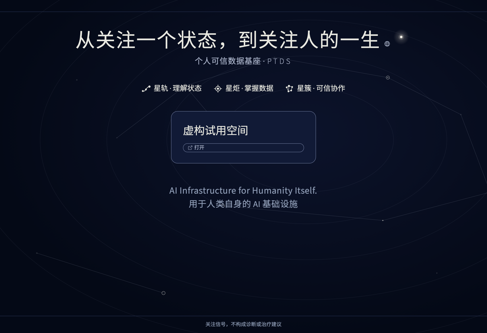
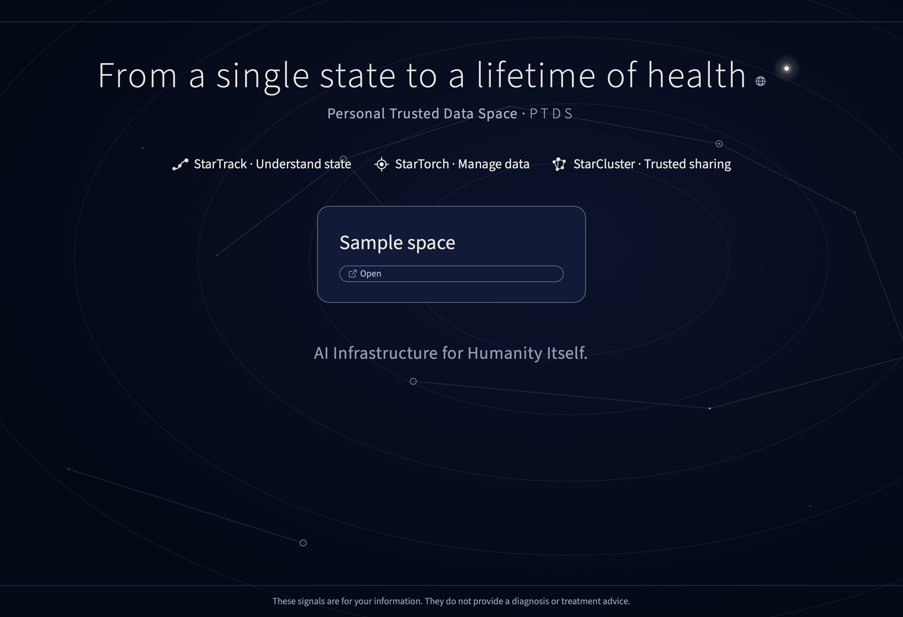
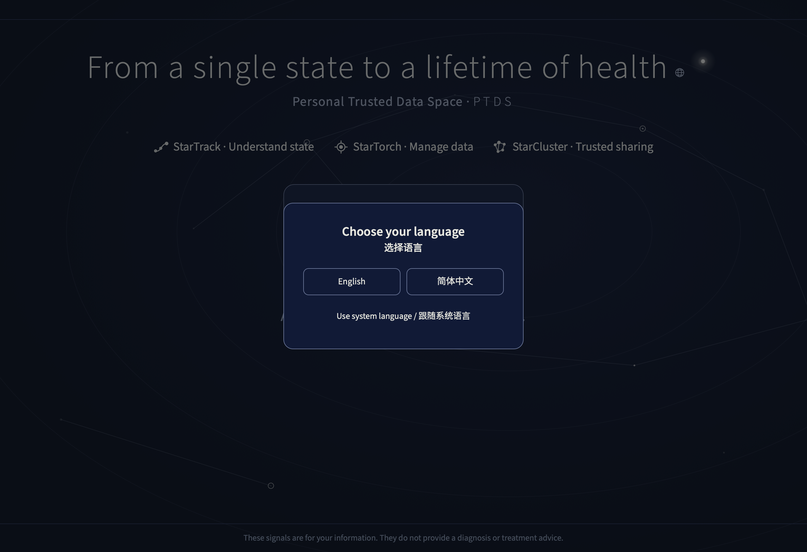
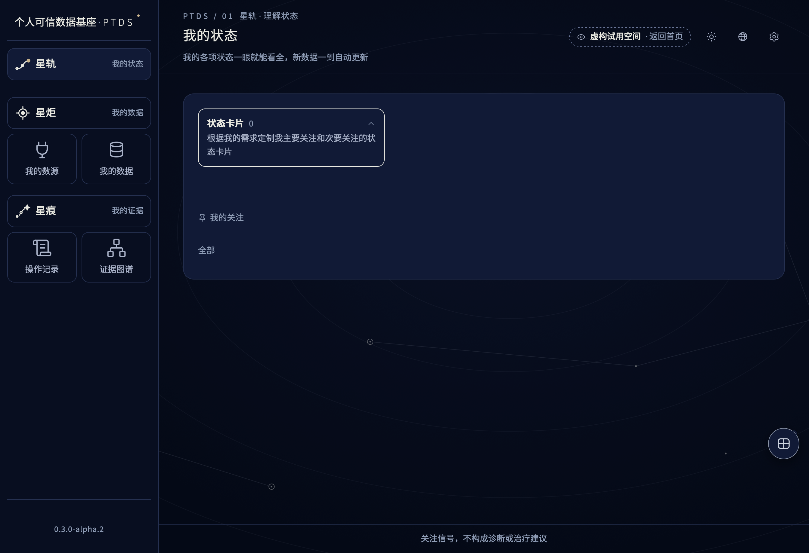

# PTDS v0.3.0-alpha.2

[English](README.en.md)


Local-first personal health data space for macOS. Trial release. [English guide](README.en.md).

[](https://github.com/osszhaoke/ptd-substrate/actions/workflows/ci.yml) [](LICENSE) [](CHANGELOG.md)

本机优先的个人可信数据基座。你的健康数据留在自己的 Mac；默认只监听本机，离线使用。试用结果是关注信号，不构成诊断或治疗建议。

## 实际画面
| 首页 · 简体中文 | 首页 · English |
| --- | --- |
|  |  |




## 你可以做什么
星炬管理数据与来源，星轨展示状态卡，星簇组织授权与协作。伙伴版先从 CSV 和本人核对开始，星簇授权入口关闭。用户命名和原始记录保留原文。

## 快速开始
在 macOS 上从 [Release](https://github.com/osszhaoke/ptd-substrate/releases/tag/v0.3.0-alpha.2) 下载压缩包和外部 SHA256SUMS。先在下载目录执行 `shasum -a 256 -c SHA256SUMS`，校验成功后解压。进入解压出的目录，运行 `sh scripts/verify_release.sh`。随包安装器只用 Python 标准库。本次演练使用 macOS 27.0.1、Apple Silicon、Python 3.14.8；其他组合尚未验证。详细步骤见[安装说明](AGENT_INSTALL.md)。

以下示例由本人先选择目录、名称和时区。使用新目录及未使用的实例标识。以普通用户运行。
```sh
SPACE_ROOT="$HOME/PTDS-trial-spaces"
SPACE_ID="partner-demo"
SPACE_NAME="Sample space"
SPACE_TZ="Asia/Shanghai"
TRIAL_CONFIG="$SPACE_ROOT/partner-settings.json"
```

```sh
mkdir -p "$SPACE_ROOT"
PYTHONPATH="$PWD/app:$PWD/app/core" python3 -B app/core/ptds_instance.py \
  --root "$SPACE_ROOT" --id "$SPACE_ID" --kind DEMO --accept SYNTHETIC --tz "$SPACE_TZ" --name "$SPACE_NAME"
python3 -B app/tools/partner_trial_setup.py --data-root "$SPACE_ROOT" --output "$TRIAL_CONFIG"
python3 -B scripts/start_trial.py --root "$SPACE_ROOT" --config "$TRIAL_CONFIG"
```

在交互安装器中选定键 PARTNER，输入上面同一实例标识、显示名和时区，选 1（虚构）。核对后由本人输入 YES 创建配置。在终端给出的 127.0.0.1 地址首开选择语言，打开实例 → 我的数源 → 来自文件报告 → CSV 表格，可选择 data/sample-import.csv 查看两行待核对记录。原文件中的两个时刻相同，同时保存会被拒绝。要练习保存，请按[试用任务](docs/community/trial-tasks.md)生成有两个时刻的虚构副本，对照两行后由本人确认。用 Ctrl+C 退出。

| 中文模块 | 英文名 | 作用 |
| --- | --- | --- |
| 星炬（torch） | StarTorch | 管理数据和来源。 |
| 星轨（track） | StarTrack | 理解状态，查看状态卡。 |
| 星簇（cluster） | StarCluster | 管理授权与协作。 |
| 星痕 | StarTrace | 查阅记录、追溯证据。 |

如需新建接收真实和虚构两种性质的本人空间，请在全新目录用 `--kind REAL --accept REAL SYNTHETIC` 建库，安装时选 2。原有空间与所选范围不一致时会被拒绝，原数据保留。

导入文件前，先读[健康与隐私](docs/community/health-and-privacy.md)。第一次体验可以跟着[试用任务清单](docs/community/trial-tasks.md)逐步操作。

## 能力与证据
| 功能 | 证据状态 | 本版体验 |
| --- | --- | --- |
| 基因原始文件 | 仅虚构验证 | 导入、查询、覆盖核对及按文件删除，不解读。 |
| 化验单本机识别（OCR，本人逐项核对后保存） | 仅虚构验证 | 保存前逐项核对候选值与原文位置。 |
| CSV、本人核对与保存 | 仅虚构验证 | 原样样例可核对两行；有两个时刻的虚构副本可由本人确认后保存。 |
| 列表、明细与来源 | 仅虚构验证 | 查看选定空间的读数与来源关系。CSV 练习的原文可用你保留的文件核对。 |
| 更正与删除 | 仅虚构验证 | 更正与撤回追加历史版本。 |
| 中英文与首开选择 | 仅虚构验证 | 首开选语言，顶部地球可再切换。内页显示对应语言的免责声明。 |
| Oura | 仅虚构验证 | 自建应用，按实例保存本机凭据，真实授权由本人操作。 |
| Garmin、Whoop | 仅虚构验证 | 提供离线检查说明；账号接入未提供。 |
| 星灵 | 仅虚构验证 | 伙伴版隐藏入口与浮动按钮。 |
| 手机、腕带桥接、授权分享 | 未提供 | 伙伴版隐藏相关业务入口。 |
| 首页编辑 | 未提供 | 使用默认首页文字。 |
| 维护者本人验收 | 待复验 | 尚未登记本版签收。 |

## 已知问题

- 本版先使用 CSV 表格导入。保存前，请本人核对候选内容、目标和数据性质，再确认保存。
- Oura 需要本人配置并完成授权。Garmin 与 Whoop 当前只提供只读检查提示，不提供账号接入。
- 数据较多时，保存和打开页面可能需要等待。
- 健康数据保存在本机；不要在反馈中附上未经脱敏的健康内容或凭据。
- 反馈请提供截图和操作步骤。截图中如有个人信息，请先遮盖。

[本版安装包已发布](https://github.com/osszhaoke/ptd-substrate/releases/tag/v0.3.0-alpha.2)。维护者本人验收仍待登记。

你可以更正或删除一条数据。删除后它会从当前列表消失，历史版本仍可追溯。请先核对选中的实例和记录。

伙伴版不展示授权与分享、状态实验室与规则编辑、卡片图钉与设置、阈值、批量导入、用药、证据包、笔记、手机分享、腕带桥接、提醒日历、个人资料编辑和设备小尾巴设置。设备说明仍可查看。Garmin 和 Whoop 仅提供只读检查。伙伴版不提供星灵。

伙伴版首页标题与卡片文字不可自定义。

选择 English 后，实例名称、用户命名、来源描述、历史记录正文保留原文。能确认由系统生成的表格导入标签随语言显示。真实上传文件名、未知模板和用户正文保留原文。

伙伴版只请求已提供的能力。手机桥接未开放。基因原始文件只在本机纳管，支持属性、位点查询、覆盖核对与按文件删除，不提供疾病或风险解读。

iPhone 同步快捷指令在本机说明中名为“同步到星炬”。

虚构测量中位数（每档 3 次，Mac16,1、Apple M4、16 GiB、macOS 27.0.1、Python 3.14.8）。保存为整批事务时间；首开和刷新为本机浏览器读完并重绘列表的时间。

| 行数 | 保存整批（秒） | My data 首开（秒） | 点击 Reload（秒） |
| ---: | ---: | ---: | ---: |
| 1,000 | 0.136 | 0.074 | 0.049 |
| 10,000 | 1.370 | 0.219 | 0.147 |
| 76,000 | 10.493 | 1.198 | 0.879 |

未签名、未公证，计划签名与公证。Windows 未支持，真实体验耗时未验收。

## 仓库结构
`app/` 产品与安装器；`scripts/` 校验与启动；`data/` 虚构 CSV；`tests/` 显式发布测试；`docs/` 双语手册和截图；`licenses/` 第三方声明；`SBOM.json` 依赖清单。

## 离线测试
在新解压目录或干净 clone 中，用独立 HOME 运行。显式发布测试不依赖 Node；开发阶段的语言与设备组件测试使用 Node，不在公开安装清单内。
```sh
sh scripts/verify_release.sh
python3 -B -I scripts/check_publication.py
python3 -B -I tests/release_smoke.py
```

维护者可运行 `python3 -B scripts/build_release.py --out ../ptd-substrate-v0.3.0-alpha.2.zip` 从已核对的目录重建 ZIP。外部 SHA256SUMS 核对 ZIP；包内同名清单核对仓库所有其他文件。清单自身由外部封存和 ZIP 摘要绑定。

## 文档与反馈
| 说明 | 文档 |
| --- | --- |
| 安装与首开 | [安装](docs/guides/install-macos.md) · [首开](docs/guides/first-run.md) |
| 可穿戴设备 | [Oura](docs/guides/oura.md) · [Garmin](docs/guides/garmin.md) · [Whoop](docs/guides/whoop.md) |
| 产品、架构、隐私与操作 | [文档索引](docs/README.md) |
| 伙伴指南 | [健康与隐私](docs/community/health-and-privacy.md) · [试用任务清单](docs/community/trial-tasks.md) · [卸载与删除](docs/community/uninstall.md) · [常见问题](docs/community/faq.md) |
| 隐私、支持与计划 | [威胁模型](docs/community/threat-model.md) · [反馈指南](docs/community/feedback.md) · [更新方式](docs/community/updates.md) · [路线图](docs/community/roadmap.md) |
| Agent 安装 | [安装协议](AGENT_INSTALL.md) |

[参与贡献](CONTRIBUTING.md) · [行为准则](CODE_OF_CONDUCT.md) · [安全报告](SECURITY.md) · [变更记录](CHANGELOG.md) · [Apache-2.0](LICENSE) · [第三方声明](NOTICE)

首开选择只在当前浏览器写入一个 ptds-language 偏好以记住语言。选择时没有网络请求，也不写服务端或业务数据。

伙伴版使用本机 Vision 和同义词表识别化验单，不使用或下载模型。首次使用需 Xcode 命令行工具。手写和模糊照片可能降低识别率。请对照原件逐项核对数值、单位和采样时间，再保存。一次仅可核对一份不超过 64 MiB 的文件，核对期限为 30 分钟；放弃可清理草稿。随包化验单为虚构样例。

[化验单识别常见问题](docs/OCR-FAQ.md)

伙伴版使用从本次安装源码编译的 Vision 程序。每次重开 PTDS 后，首次识别或预览 PDF 都需要 Xcode 命令行工具。同一指标的多条结果分别进入核对列表，请分别对照原件。

识别需要能区分项目、结果和单位的表头。参考限值、含多个数值的结果、无法核实的单位均不能勾选保存。系统核对实际启动程序的身份后才开始读原件。未匹配行可对照原件手工录入。

表格换段后，须出现可核实的新结果表头。已有原文和分页记录出现冲突时会停止保存。

旧批次和整份导入共用同一 PDF 时，PTDS 核对页码、原文与已存记录后显示来源。无法唯一定位的行会显示不可用。

若保存的来源原文与已登记的结果相互矛盾，系统会提示无法定位原文。参考区间里出现相同数字不能代替结果。

化验单的提示栏或参考区间可以留空。只要其余列能确定唯一结果，就可以查看对应原文。证据图谱的原件详情跟随所选语言，原文件名保留原文。

化验单的提示栏可含“正常”等文字。打开已保存结果时，PTDS 会核对原文行里的结果和单位。

回溯结果时，PTDS 会比对已记录的来源文字与原文行。两者相互矛盾时，界面提示无法定位原文。已保存的结果仍在数据空间里。

较早的化验单有时在项目名前印有行号。打开已保存的结果，可查看带原行号的对应原文。属于指标名本身的数字会保留。
