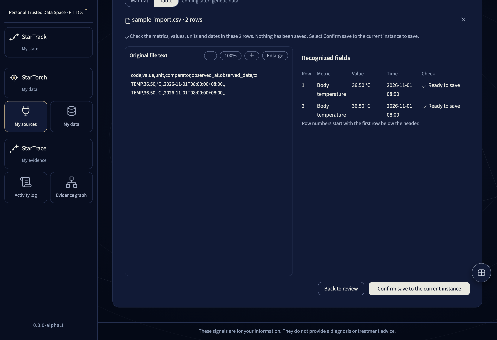

# First launch

[简体中文](first-run.md)

## Language
English is on the left and Simplified Chinese on the right. Choose System below to follow your device. Traditional Chinese preferences display Simplified Chinese. English is used when neither language is in the preference list. Use the globe to change later.

## Review the sample
Open the space. Choose My sources → Files and reports → CSV file. Select the bundled sample. Check both values and times. Stop at review.

